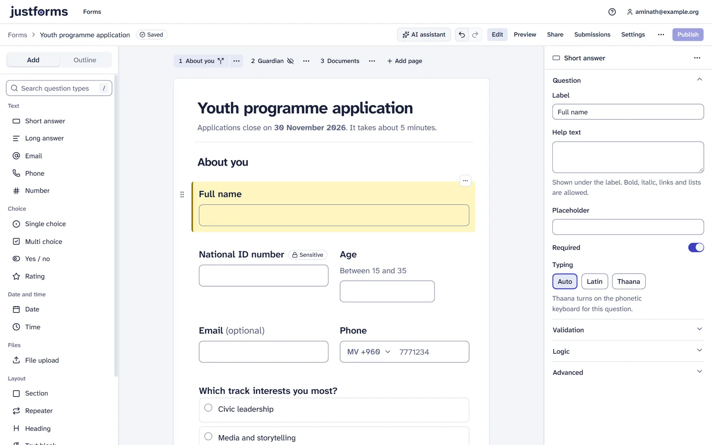
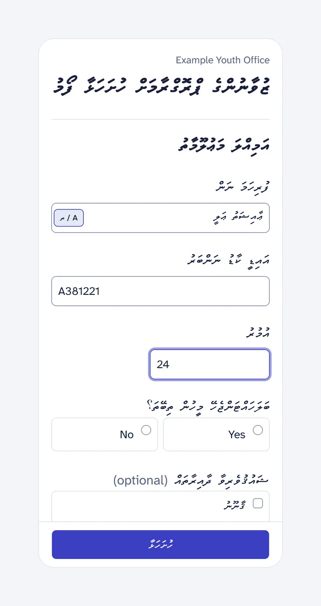
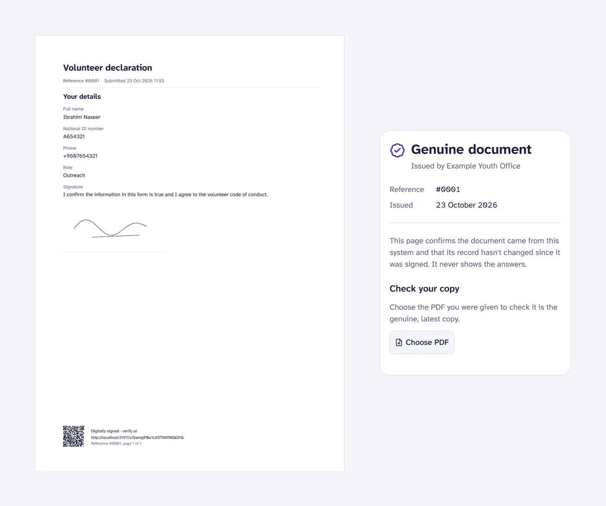
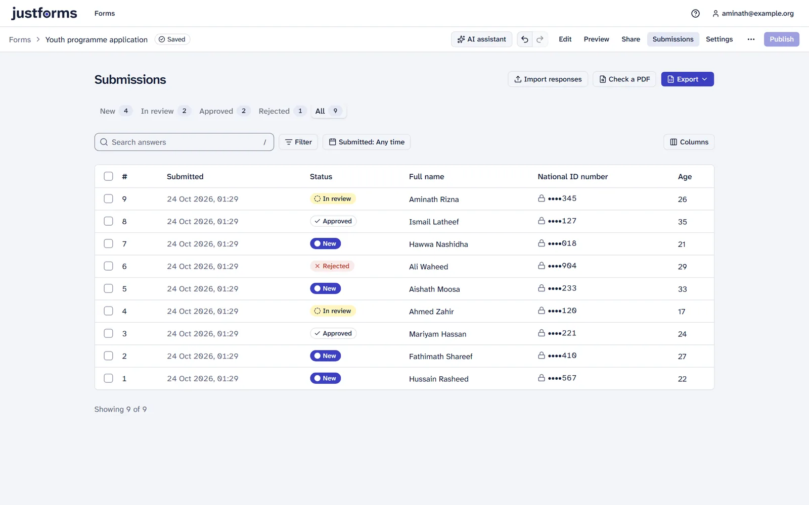
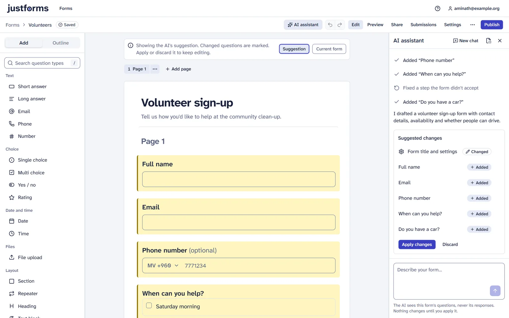

# Features

A tour of what JustForms does. For settings see [Configuration](configuration.md); for the
reasoning behind each part see the [design document](DESIGN.md).

- [Languages: English and Dhivehi](#languages-english-and-dhivehi)
- [Building forms](#building-forms)
- [Logic](#logic)
- [Filling forms](#filling-forms)
- [Form addresses and embedding](#form-addresses-and-embedding)
- [Signatures, signed PDFs and the verify page](#signatures-signed-pdfs-and-the-verify-page)
- [Approvals](#approvals)
- [Submissions and export](#submissions-and-export)
- [Emails and webhooks](#emails-and-webhooks)
- [AI assistant](#ai-assistant)
- [Jotform import](#jotform-import)
- [People and roles](#people-and-roles)
- [Branding](#branding)
- [Appearance and form themes](#appearance-and-form-themes)
- [Running it](#running-it)

  

## Languages: English and Dhivehi

Each form is written in **English or Dhivehi**. Dhivehi forms are right to left in Thaana
fonts, with a phonetic Thaana keyboard for answers. Everything around the form (the studio, the
public form's buttons and messages, emails, the verify page and the PDF's labels) is English.

The Thaana font stack is `Faruma, "MV Faseyha", "Noto Sans Thaana", sans-serif`. Only Noto Sans
Thaana (SIL OFL) is bundled; Faruma loads from a font service by default and can be self-hosted
(see [Thaana fonts](configuration.md#thaana-fonts)).

  

## Building forms

- Question types: short and long answers, email, phone, number, single and multi choice,
  yes/no, rating, date, time, file upload and drawn signature; plus sections, repeating groups,
  headings and text blocks.
- **ID number**: a short answer with an identity-number format chosen in the inspector. Presets
  (for example *Maldives national ID card*, `A123456`) bring the pattern, placeholder, error
  message and length, remove spaces and use capital letters while the respondent types (and
  again on the server), always type Latin, and start out marked sensitive. **Custom** uses your
  own pattern, placeholder and message. Presets are data
  (`backend/app/schemas/id_presets.json`), so more countries are one entry each. Exports,
  Insights and Ask treat the answers as text.
- The canvas looks exactly like what respondents will see.
- Autosave, undo and redo, live preview, and published versions: respondents always fill the
  version you published, while you keep editing the draft.

## Logic

Multi-page forms with show, hide, require and skip-page rules. Rules are checked for cycles,
and the same logic engine runs in the browser and on the server.

## Filling forms

- A small, fast public form (initial JavaScript under 120 KB gzip) made for mid-range phones.
- Answers are validated the same way in the browser and on the server.
- Progress is saved on the respondent's device (browser storage) while they type, so a closed
  tab or a reload loses nothing: the form reopens with their answers and page and a small
  notice with **Start over**. Sensitive questions, signatures and files are never kept; saved
  progress expires after 7 days by default and is cleared on submit. Owners can change the
  expiry or turn it off for forms used on shared or kiosk devices (Settings › Access).
- Access: open to anyone with the link, to people who confirm their email first, or to
  signed-in staff.
- Rate limits and optional CAPTCHA per form (off, always, or only when busy).

## Form addresses and embedding

A published form lives at `https://<your-host>/<address>`. Addresses are unique across the
install; a new form takes one from its title and owners can change it on the Share page, which
checks it as they type. Words the app uses itself (`login`, `forms`, `settings`, `api`,
`assets`, ...) can't be addresses. Links in the old `/f/<org>/<address>` form redirect
permanently.

Dhivehi titles are written in Latin letters by the official romanisation rules of 23 May 1977,
so a form titled ކަނޑި gets `/kandi` rather than a generic `/form`; mixed English and Dhivehi
titles keep both parts. Thaana typed into the address field is romanised the same way. When an
address changes, the old one keeps working: it redirects (301) to the new address, embeds and
link-preview images included, and no other form can take it until the form is erased. Dhivehi
forms still at a generic address (`form`, `form-3`) are offered a readable one on the Share page
in one click.

Forms can be embedded in other websites with `?embed=1`; each form can limit which sites may
embed it (any site when the list is empty).

## Signatures, signed PDFs and the verify page

  

Signatures are kept as raw strokes and re-rendered, with when, from which IP address and device
the form was signed, and the statement the signer saw. Every submission has a SHA-256 content
hash and a hash-chained activity log, and every signed submission gets a **PAdES signed PDF**.

The PDF is the respondent's copy: title, answers, signatures, reference, submission date, the
approval record and a footer QR code. The IP address, device and hashes are not printed; they
stay in the studio and in the file's metadata. The verify page (`/v/{token}`) says only whether
the document is genuine and unchanged, with its reference, issue date and approval outcome,
never the answers. People can also upload their copy there to check it.

How signing keys work and how to check a PDF:
[Security](security.md#signed-pdfs-and-the-verify-page).

## Approvals

Up to three **approval steps** per form. Approvers get an email with **Approve** and **Reject**
buttons and need no account: a button opens the response with that choice made, they confirm
their email with a code and then their decision. The link works for
`JUSTFORMS_APPROVAL_LINK_DAYS` (14 by default). Editors and owners can also approve or reject the
waiting step in the studio, one submission or a selection at a time; the approver's link then
says who decided. The request and outcome emails' wording (and the outcome's Reply-To) can be
set per form, with test emails to yourself. A step can instead be decided **only in the studio**
by people with edit access (editors, owners, organisation admins), signed in: no approver link
and no code. Up to 10 notify addresses (for example a shared mailbox), and optionally everyone with
edit access, get a "New response to review" email with a button to the submission. The outcome
is part of the signed PDF's approval record and shows on the verify page.

## Submissions and export

  

A submissions table with search, filters, sorting by any column (answers by their type: text
alphabetically, numbers by value, dates by time, choices in option order), status (New, In
review, Approved, Rejected), comments, an activity log and export to Excel. Sensitive answers are marked with a lock, and opening a submission that has them is recorded.

**Trash.** Deleted submissions and forms can be brought back: deleting shows an Undo toast, and
owners find them under Submissions › Deleted and Forms › Trash for 30 days (configurable) before
they are erased for good. Restored submissions keep their reference numbers; restoring a form
brings back its submissions too.

**Insights** (Submissions › Insights) summarises every question under the same filters: counts
and shares per option with the "Other" answers, averages, medians and histograms for numbers
and ratings, answers per month for dates, the newest text answers, rows of repeaters (older
versions' questions mapped onto a repeater count as rows). Click a bar to open the submissions
behind it; any chart can be shown as a table or downloaded as a PNG. No AI is involved.

**Where people get stuck** (on the Insights page) shows how far visits got in the last 30 days
(opened, started answering, reached each page, submitted) and which questions showed people
a problem, with the kind of problem (left empty, wrong format, out of range...). The public
form sends only anonymous counts: page keys, question keys and problem codes, never answers,
no cookies (see [Security](security.md#where-people-get-stuck-respondent-friction)). Owners
can turn it off per form in Settings › Access.

**Error tracking** (optional): the API, worker and browser pages can report errors to a
Sentry-protocol server such as Sentry or GlitchTip, with answers and personal data scrubbed
([Security](security.md#error-tracking)).

## Emails and webhooks

- Email to the form's owners or up to 10 other addresses, and a receipt for the respondent
  (to their confirmed email or an email question), optionally with the signed PDF.
- Custom subject, message and Reply-To per email, with placeholders such as `{reference}` and
  `{answer:question_key}`, and a "Send test emails" button that sends both to you with sample answers.
- Signed **webhooks** with retries. Outbound URLs are resolved, checked against private ranges
  and pinned. Events, payloads and verifiers: [webhooks.md](webhooks.md).

## AI assistant

  

With a provider configured ([AI assistant settings](configuration.md#ai-assistant)), editors can
describe a form and get a draft, ask for changes ("add a phone question after email, show page 2
only to people who answered Yes"), or upload a **blank** paper form to recreate it.

The AI only calls schema tools; each change is validated and shown on the canvas as a
suggestion to apply (one Undo reverts it) or discard. Only the form's questions go to the
provider from the builder, never responses, and paper forms must be confirmed blank each time. Dhivehi wording
from the AI is a draft to check. Unset, every AI feature is hidden.

**Ask your submissions** (on Insights) answers questions such as "how many organisations want
to know about disability rights?" for anyone who can see the submissions. The AI counts with a
small, safe query language that runs on the server (it never writes SQL), every number comes
from those counts, and each answer shows how it was calculated with a link to the matching
submissions. Ask it to list things ("contact number of all CSOs") and it shows a table read
straight from the database, exact values you can sort, copy or download as CSV; the AI never
types them. By default only the questions, counts, and sums, averages and groups over at least 5
submissions go to the AI service, never a single submission's answers (lists go to you, not
to it); an owner can turn on **Settings › AI › Allow AI to read answers** (off for every
form until then) so it can read every answer, contact details and sensitive questions
included, to summarise or reason about them (the answers of at most 500 submissions per
question). Answers keep lists as what was listed and read them again when opened, so
deleted submissions drop out. Files,
signatures and IP addresses are never sent. The studio never names the AI provider.

Behind your own reverse proxy, see [Deployment](deployment.md#reverse-proxies) for the
streaming settings the assistant needs.

## Jotform import

Teams leaving Jotform can bring their forms and submission history with them. The importer is
ordinary parsing code, not AI.

- **Forms** come from the form's public link, its pasted or uploaded HTML source, or the
  Jotform API with a key that is never stored. Question types are mapped, collapses become
  sections, inline conditions are translated where they can be, and Thaana text is detected
  to suggest a Dhivehi form.
- A per-question **import report** says what was imported, changed or skipped, and why. The
  result becomes an ordinary draft to review before publishing.
- **Submissions** come from Jotform's `.xlsx` or `.csv` export: JustForms suggests a column
  mapping, previews the first rows and imports them in one go, skipping rows already imported.
  Imported rows send no notifications.

The full mapping is in [DESIGN.md §13](DESIGN.md#13-import-from-jotform).

## People and roles

- Three organisation roles: **Admin** (everything, including organisation settings, people and
  branding; owner of every form), **Form creator** (creates and imports forms, sees the ones
  they created or that are shared with them) and **Member** (sees only the forms shared with
  them). Each form also has its own owners, editors and submissions viewers (can view and export
  submissions, can't edit the form).
- Organisation settings › People lists everyone with their role, status (active, never signed
  in, invited, invite expired) and last sign-in, with search.
- Invite several people at once by email with a role. They get a branded email with a link to
  a prefilled sign-in page; the link works for 14 days. Resend, cancel or change the role of a
  pending invite. With single sign-on, the invitation is accepted when that email signs in.
- Change someone's role or remove them (their access to the organisation's forms goes with
  them). An organisation always keeps at least one admin.
- Sharing a form with someone who isn't in the organisation yet: admins invite them and share
  in one step; they get the form role when they accept.
- Sharing a form with a member, or giving them a higher role, can email them ("Notify by
  email", on by default) with an optional note; replies go to the person who shared it.
- Superadmins can do all of this in every organisation.

## Branding

JustForms' name, logo and colour can be replaced by each organisation's own. Organisation
admins open **Organisation settings** from the account menu and set a display name, a logo (PNG
or SVG, plus an optional dark-mode version), a square icon (favicon and app icon), a primary
colour, a support link and whether "Powered by JustForms" shows. A live preview shows the studio
and a form in light and dark, phone and desktop.

The branding appears on the studio header and sign-in page, browser tab and installed app,
public forms, approver and verify pages, emails (sender name, logo, footer), signed PDFs and
Excel exports. The colour is checked for contrast and adjusted when needed, so text on
buttons and links stays readable (WCAG AA). SVGs are cleaned on upload and every image is
served from JustForms' own origin, so the Content-Security-Policy stays tight.

Instance defaults ([`JUSTFORMS_BRAND_*`](configuration.md#branding), or `branding.*` in the
Helm chart) apply to organisations that set nothing; with nothing set anywhere JustForms looks
like JustForms. The sign-in page uses the default organisation's branding.

## Appearance and form themes

The studio is light unless someone picks **Dark** or **Match device** in their account menu;
the choice is saved on their account.

Forms, and the approver and verify pages that belong to them, look the way the organisation's
**form theme** says (Organisation settings, below Branding):

- colours, checked and adjusted so text stays readable, with dark-mode colours generated from
  them;
- a Latin font from a curated set of open-licence fonts served by JustForms itself, and a
  Thaana font from `JUSTFORMS_THAANA_FONTS`;
- text and heading size, corners, spacing, page width, button and input style, the progress
  bar and the logo position;
- header and background images;
- whether people filling it in see it light, dark or matching their device (light by default).

Each form can change any of these on its Settings page; everything it doesn't change follows
the organisation. Both pages have a live preview of an English and a Dhivehi sample on a phone
or desktop. The theme also colours email buttons and the title rule and headings of signed PDFs.

## Link previews

Every published form has its own link card for chat apps and social sites: the page sends the
form's title, description, address and an image in its HTML (Open Graph and Twitter card tags),
so a pasted link shows a proper preview. The image (1200 × 630) is generated from the form's
title and description, the organisation's or form's logo and the form theme's colours, in
Dhivehi right to left for Dhivehi forms, and is made again whenever any of those change. On
the form's **Settings › Sharing preview** editors can set a different share title and
description, upload their own image (cropped to the card's shape) or go back to the generated
one, with a preview of the card in a chat app, a social feed and a short post. Links to
unpublished or unknown forms show only the site's name.

## Running it

- Docker Compose for one server, a Helm chart for Kubernetes: see [Deployment](deployment.md).
- Staff sign in with OIDC (Entra ID, Keycloak, any standard provider) or emailed one-time codes;
  admins invite people by email.
- Files on a local volume or any S3-compatible service.
